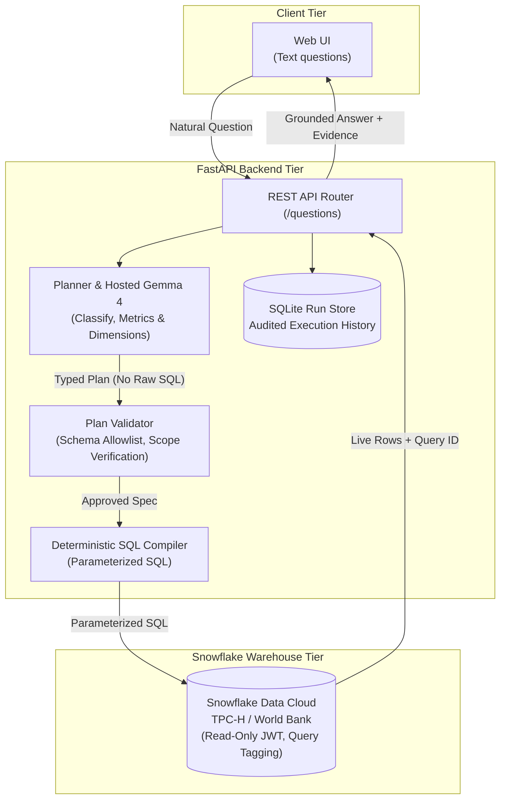

# PS1 — DataMind: Talk to Your Data

## Working backend and team setup

The implemented FastAPI backend lives in [`datamind-backend/`](datamind-backend/).
It supports hosted **Gemma 4 via Google AI Studio** (configured locally) and a local Gemma fallback, real **World Bank World Development Indicators** loaded into
Snowflake, and Snowflake's **TPC-H SF1** sample data.
It supports aggregates, two-cohort comparisons, subset percentages and pooled-average
analysis with SQL, query IDs and calculation evidence.

- [Backend installation and launch](datamind-backend/README.md)
- [Frontend API contract](datamind-backend/UI_HANDOFF.md)
- [Connect a teammate's laptop to Snowflake](datamind-backend/TEAM_ACCESS.md)
- [Measured results and remaining live-verification limits](datamind-backend/VALIDATION.md)

The backend has **96 passing automated tests**. Hosted Gemma has passed live single-value
and comparison checks against Snowflake. Full hosted evaluation is still pending;
see the validation record for earlier local-model results.

> **Problem statement (ZeroDay OSS Hacktoberfest 2026, PS1).** Organizations hold large
> amounts of data, but getting answers from it usually takes SQL skills or hours of manual
> searching, so the people who understand the questions best are often the least able to
> reach the data. Build an AI-powered data experience where people ask questions in everyday
> language and get answers grounded in the real data, with enough explanation (query, rows,
> gaps) to trust them. Required technology: **Snowflake** for data and querying, **Google
> Gemma** for the AI task, delivered as reusable open source.

## DataMind — our solution

Ask a question in plain language; get an answer **computed by SQL in Snowflake**,
planned by **Gemma**, with the executed query, the Snowflake query ID and the
result rows shown beside it. If the question is ambiguous, unanswerable from the
data, or unsafe, DataMind says so instead of guessing.

Built for ZeroDay OSS Hacktoberfest 2026 — PS1 "DataMind: Talk to Your Data".

## How it works

### System Architecture



Gemma never writes raw SQL: it produces a typed plan restricted to configured metrics,
filters and limits, and Python compiles that plan into parameterized SQL.
Details: [backend architecture and safety](datamind-backend/README.md#architecture-and-safety).

## Repository layout

```
datamind-backend/    the working system: FastAPI app, dataset configs, evaluation, tests
docs/COMPLIANCE.md   status of every PS1 gate, mandatory feature and submission item
team/                who owns what
```

Everything else at the top level (`src/datamind/`, `config/`, `snowflake/`, `eval/`,
`tests/`, `pyproject.toml`, `docs/ARCHITECTURE.md`, `docs/DATASETS.md`) is the
**legacy skeleton**, described at the end of this file. It is not used by the demo.

## Setup and run

Follow [datamind-backend/README.md](datamind-backend/README.md): Python 3.13,
[Ollama](https://ollama.com) with `gemma3:12b` (about 8 GB memory; `gemma3:4b` is a
weaker fallback), and a Snowflake account. A [30-day trial](https://signup.snowflake.com)
works; no paid services are required. A teammate's laptop is set up with
[TEAM_ACCESS.md](datamind-backend/TEAM_ACCESS.md).

## Datasets and licences

- **World Bank World Development Indicators** (CC BY 4.0): 18 real indicators (GDP, population,
  life expectancy, inflation, internet use, CO₂ and more) for 217 countries, 1990–2024, loaded
  into Snowflake from the World Bank API. Source, preparation and reload steps:
  [WORLDBANK_DATA.md](datamind-backend/WORLDBANK_DATA.md).
- **TPC-H SF1** from Snowflake's shared sample database, queried in place, not redistributed.

No data files are committed.

## Testing results

- **96 automated tests** pass; Ruff passes.
- **Hosted Gemma smoke checks:** India's 2022 life expectancy and 2015–2023 internet-use
  comparison returned correct values with Snowflake query IDs.
- **Plan cache:** a live repeat dropped from 16.11s to 1.43s, with different Snowflake
  query IDs. Only validated plans are cached; SQL executes on every request.
- Full hosted evaluation and the World Bank data-change proof remain pending.

Full record, including the precision bug the first live run caught:
[VALIDATION.md](datamind-backend/VALIDATION.md).

## Tested environment

| | |
|---|---|
| OS / hardware | macOS, Apple M5, 16 GB RAM |
| Python | 3.13 |
| Model | Gemma 3 12B (`gemma3:12b`, Ollama 0.31.1), 8,192-token context |
| Date tested | 18 October 2026 |

## Known limitations

- Answers questions only within each dataset's configured metrics, filters and groupings;
  anything else is refused or sent back for clarification.
- One question at a time on a local development server (127.0.0.1); not for public exposure.
- Each answer takes two model calls; on the tested Mac that can be tens of seconds.
- No conversation memory: follow-up questions must be self-contained.
- The frontend is served at `http://127.0.0.1:8000/`; the API contract is in
  [UI_HANDOFF.md](datamind-backend/UI_HANDOFF.md).

## Reproduce the demo

_TODO: exact question list and steps used in the recording._

## Technical contribution

DataMind keeps the language model away from SQL. Gemma 3 turns a question into a typed
plan over a dataset's configured vocabulary. Python validates the plan, compiles
parameterized SQL, and computes any comparisons with exact decimals. Every number in the
answer links back to a Snowflake query ID and result cell, and an evaluation harness checks
those numbers against independent oracles.

## Legacy skeleton (not used)

`src/datamind/` and its supporting files are the team's first design. It used Gemma 4 via
AI Studio, model-written SQL guarded by a validator, and a Streamlit UI. It was superseded
by `datamind-backend/` before the pipeline was finished: several functions still raise
`NotImplementedError`. It is kept for history only and is not part of the submission.

## Licence

MIT — see [`LICENSE`](LICENSE). Datasets and model weights carry their own licences.
