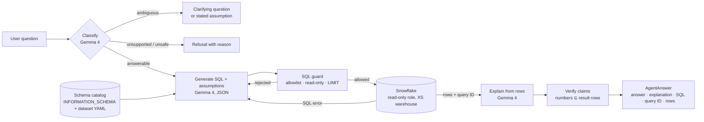

# Architecture

> **Legacy document.** This describes the superseded `src/datamind/` skeleton (Gemma 4, Streamlit).
> The working system is [`datamind-backend/`](../datamind-backend/README.md).

DataMind answers a plain-language question by **running SQL in Snowflake** and
using **Gemma 4** only to interpret the question and explain the returned rows.
The model never executes anything; code never invents facts.

## Responsibilities

| Concern | Owner | Module |
|---|---|---|
| Dataset definition (tables, joins, glossary, limits) | YAML config | `config/datasets/*.yaml`, `src/datamind/config.py` |
| Live schema discovery | Snowflake `INFORMATION_SCHEMA` | `schema.py`, `snowflake_client.py` |
| Question classification (answerable / ambiguous / unsupported / unsafe) | Gemma 4 | `agent.py` |
| NL → SQL with explicit assumptions | Gemma 4 | `agent.py` |
| Safety: single read-only SELECT on allowlisted tables, row cap | Deterministic code + Snowflake role | `sql_guard.py`, `snowflake/00_setup.sql` |
| Query execution, query IDs | Snowflake | `snowflake_client.py` |
| Plain-language answer + explanation from rows | Gemma 4 | `agent.py` |
| Claim verification (no unsupported numbers) | Deterministic code | `agent.py` (`verify`) |
| Evidence display | Streamlit | `app.py` |
| Ground-truth comparison | Eval runner + hand-written SQL | `eval_runner.py`, `eval/` |

## How Snowflake is used (S6)

- All data behind every answer lives in and is queried in Snowflake at question time.
- Primary dataset `SNOWFLAKE_SAMPLE_DATA.TPCH_SF1` is shared into the account (not copied).
- The app connects as `DATAMIND_READER`: read-only, limited to the dataset databases.
- `DATAMIND_WH` is X-Small, auto-suspends after 60 s, and sits under a resource monitor.
- Every app query is tagged `QUERY_TAG='datamind'`, so evidence can be pulled from
  `QUERY_HISTORY` and the query ID is shown beside each answer.
- Cortex features are not required and not used by default.

## How Gemma 4 is used (S6)

| Step | Input | Output | Validation |
|---|---|---|---|
| Classify | question, history, dataset summary | status + reason (JSON) | enum check; unsafe keywords double-checked in code |
| Generate SQL | question, history, schema block, glossary, previous error | SQL + assumptions (JSON) | parsed by `sql_guard`; repaired up to N times |
| Explain | question, executed SQL, result rows (capped) | answer + explanation | `verify`: every number in the answer must appear in rows |

Backends (config switch only, `DATAMIND_LLM_BACKEND`):

| Backend | Default model | Runs where | Notes |
|---|---|---|---|
| `ai_studio` (**default**) | `gemma-4-26b-a4b-it` | Google-hosted (Gemini API) | Free key; rate-limited per project; question, schema and capped rows leave the machine |
| `ollama` (fallback) | `gemma4:e4b` | Local machine | No data leaves the machine; weaker SQL expected from the smaller model |

Inference (Google) and data/query processing (Snowflake) are separate services;
Gemma never receives Snowflake credentials and cannot issue queries itself.

Temperature is 0 for reproducibility. Every `LLMResponse` records the exact
model id and backend, and the UI shows it.

## Why this shape

- **Correctness is capped by SQL quality, not prose quality.** The trust cap
  punishes wrong numbers, so the model's freedom is narrowest where errors cost
  most: it proposes SQL; code checks it; Snowflake computes; the model only
  rephrases rows; code checks the rephrasing.
- **Defence in depth.** The guard catches unsafe SQL early and cheaply; the
  read-only role makes it harmless even if the guard is wrong.
- **Configuration over code.** Nothing below `config.py` names a table, so a new
  dataset is a YAML file plus a load script (rubric criterion 7).

## Known design risks

- Free-tier rate limits: each question costs 3–5 model calls, so a judge firing
  questions quickly can hit 429s. Back off, and show a clear message when it happens.
- Gemma on the Gemini API has historically not supported system instructions or
  JSON mode; prompts must work without them. Verify for Gemma 4.
- Number verification is lexical; rounding and unit formatting need care to
  avoid false alarms.
